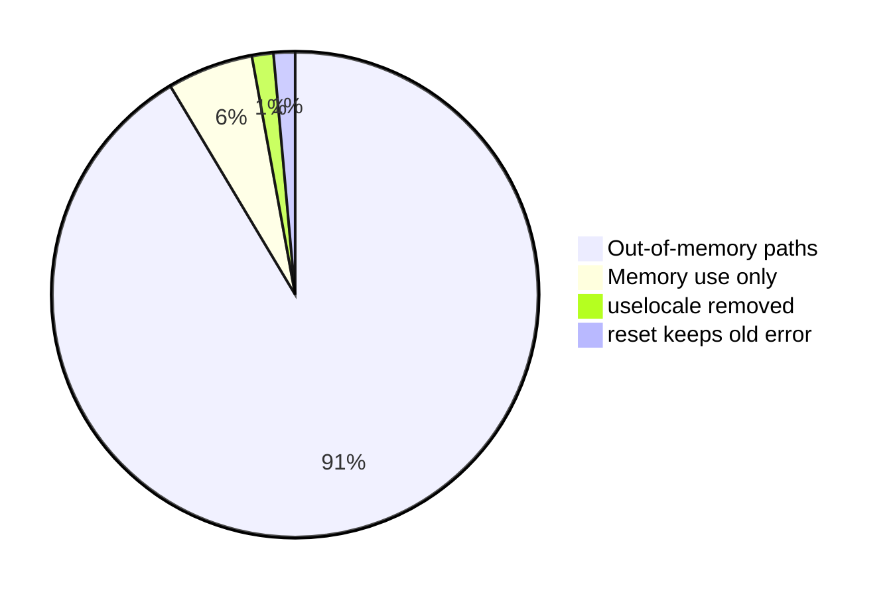

# Does the Role A gate catch a bad json-c refactor? {#role-a-gate}

Partly. The gate catches **876 of 986** catchable single-point mistakes in `json_tokener.c` (88.8%). It misses mistakes that show only on a later call, under an unused flag set, or as extra running time. A prototype with the missing calling patterns plus old-vs-new fuzzing catches **916 of 986** (92.9%) and all 9 hand-written refactor mistakes.

- The gate asks one call on a fresh tokener about each short input: 3,402 inputs, 29 ways, 98,658 answers.[](source:recorder)
- The gate passed all 9 planted mistakes, although 7 of them sit on lines it runs thousands of times.
- The 70 mistakes still missed are 64 out-of-memory paths, 4 memory-only changes, 1 locale call and 1 reset edge case.
- The gate is not enforced yet: `main` has no branch protection, and PRs #1 and #2 are still drafts.

@answer scope="json-c d2ce61e (baseline) · gate on branch a/ci at 4500010 · measured 2026-11-24 · gcc 13 with ASan/UBSan"
@meta locale=en
@source recorder title="Recorder: every way the gate calls the tokener" path=oracle/recorder.c lines=166:208
@source check title="Checker: build, run, time limit, compare" path=oracle/check.py lines=296:337
@source paths title="Path rules for pull requests" path=ci/check_paths.py lines=33:46
@source workflow title="CI workflow: paths, gate, self-test" path=.github/workflows/gate.yml lines=21:68
@source protect title="Branch protection script (not yet run)" path=ci/protect-main.sh lines=1:37
@source known title="Checker's own list of known gaps" path=oracle/README.md lines=96:116
@source finding1 title="Bug hunt finding 1: false success on an open comment" path=bughunt/README.md lines=5:13
@source reset title="Success path resets every level for the next call" path=json-c/json_tokener.c lines=1414:1424
@source review title="review-skills-before-after.md (uncommitted review notes, repo root)"

## How does a rewrite PR reach main? {#pr-flow}

@workflow id=merge-flow title="A rewrite pull request"
| lane checks | Required checks |
| lane merge | Merge |
| pr | Rewrite PR opened | external | checks |
| paths | Only tokener changed? | backend | checks |
| gate | Old vs new check | backend | checks |
| selftest | Checker self-test | backend | checks |
| review | Teammate approval | frontend | merge |
| main | Merged into main | database | merge |
| blocked | PR blocked | security | merge |
| pr > paths | |
| paths > gate | yes | emphasis |
| paths > blocked | no | dashed |
| gate > selftest | pass | emphasis |
| gate > blocked | differs | dashed |
| selftest > review | pass |
| review > main | approved | emphasis |

@steps id=merge-steps
| s-paths | Only tokener changed? | A rewrite PR may change `json-c/json_tokener.c` and nothing else, so it is always judged by the checker already on `main`. | merge-flow | paths |
| s-gate | Old vs new check | `oracle/check.py` builds the baseline and the candidate against the same json-c and compares every answer. Exit 0 passes; 1 differs; 2 crash, leak or timeout; 3 build error. | merge-flow | gate |
| s-self | Checker self-test | Runs the checker's and the path rules' own tests, so a broken checker cannot pass anything. | merge-flow | selftest |
| s-review | Teammate approval | Any teammate approves a rewrite. A change to `oracle/`, `ci/` or `.github/` needs Role A as code owner. | merge-flow | review |

@callout level=warning title="Nothing enforces this flow yet"
`main` has no branch protection (the GitHub API returns 404), and `main` does not contain `oracle/`, `ci/` or `.github/` yet.
Until PRs #1 and #2 merge, a second code owner is added and `ci/protect-main.sh` runs, any PR can merge without passing the checks.[](source:protect)

## What does the gate compare? {#what-compared}

@workflow id=check-run title="One run of oracle/check.py"
| lib | Cached json-c build | database |
| old | Baseline tokener | backend |
| new | Candidate tokener | frontend |
| runold | Run baseline | backend |
| runnew | Run candidate | backend |
| cmp | Compare answers | security |
| lib > old | |
| lib > new | |
| old > runold | |
| new > runnew | |
| runold > runnew | sets time limit |
| runold > cmp | |
| runnew > cmp | |

@steps id=check-steps
| c-lib | Cached json-c build | Everything except the tokener is built once with ASan and UBSan, so the two versions can differ only in `json_tokener.c`. | check-run | lib |
| c-old | Baseline tokener | Read from the pinned git tree `6471b8b` on every run, never from the cache. | check-run | old |
| c-run | Run baseline | Feeds all 3,402 inputs in 29 ways. Its time sets the candidate's limit: at least 10 s, or 20 times the baseline. | check-run | runold |
| c-cmp | Compare answers | Each answer has four fields: type of every value, error code, how far the parser read, and the serialized value. | check-run | cmp |

| Way of calling | Count |
| --- | --- |
| One call per input (`oneshot`, `noterm`, `minus1`, `reuse` with reset) × 6 flag sets | 24 |
| `json_tokener_parse()` and `json_tokener_parse_verbose()` | 2 |
| Depth limits 1, 5 and 64 | 3 |
| **Total per input** | **29** |

3,402 inputs × 29 ways = 98,658 answers per run, in about 4 s. The run covers 92.0% of lines and 84.3% of branches of `json_tokener.c`.[](source:check)

## Why did all 9 planted mistakes pass? {#nine-mistakes}

Every mistake changes something other than "one call on a fresh tokener, short input". Coverage gave no warning: 7 of the 9 sit on lines the gate runs between 2,331 and 163,929 times.

| Planted mistake | Why the gate cannot see it |
| --- | --- |
| Success path skips resetting level 0 | The reset only matters for the next call on the same tokener; the gate always uses a fresh or reset tokener.[](source:reset) |
| String loses its bytes when a call ends mid-string | The lost bytes would be used by a follow-up call that the gate never makes. |
| Number sign flag wrong when resuming | In one call the value is overwritten before use; the resume code never runs in the gate. |
| `st_pos` reset at every call | A fresh tokener already starts at 0, so the extra reset changes nothing in one call. |
| `quote_char` kept in a `static` | With one document in progress at a time, a `static` behaves like a per-tokener field. |
| Trailing check rewritten as an XOR | It differs only for `ALLOW_TRAILING_CHARS` without `STRICT`, a flag set the gate never uses. |
| Wrong error code for `len < -1` | The recorder only passes `len` = n, n+1 or −1; line 351 never runs. |
| `json_tokener_new_ex(0)` returns a tokener | The recorder never asks for depth below 1. |
| Quadratic work per string character | Answers stay identical. Inputs are at most 1,000 bytes, so the extra work is tiny. |

@facts
| State carried between calls | 5 of 9: the effect shows on a later call or another tokener |
| Calling patterns an input file cannot express | 3 of 9: flag sets and API arguments live in `recorder.c` |
| Not an answer at all | 1 of 9: running time needs large inputs |

## How many mutants does each layer catch? {#mutation}

```mermaid title="Mutants caught, out of 986 that can be caught (measured)"
xychart-beta
  x-axis ["Gate today", "+ prototype", "+ fuzzing"]
  y-axis "mutants caught" 800 --> 986
  bar "Caught" [876, 913, 916]
```

I generated every single-point mutant of `json_tokener.c` with mewt-style operators: 1,157 in all. 1,157 − 97 that do not compile = 1,060. Leaving out 74 equivalent or not compiled on this platform gives 986 that can be caught. 876 / 986 = 88.8%; 913 / 986 = 92.6%; 916 / 986 = 92.9%.[](source:review)



The out-of-memory branches run only when an allocation fails. The locale gap is already listed in the checker's known gaps.[](source:known)

## What did the prototype and the fuzzer add? {#additions}

| Added check | Planted mistakes it catches |
| --- | --- |
| Byte-by-byte feeding and every 2-way split | 3: string bytes, number sign, `st_pos` |
| Several documents in one input, no reset | 1: level-0 reset |
| Two tokeners fed alternately | 1: `static` `quote_char` |
| All 8 flag sets | 1: trailing XOR |
| API edges: `len = -2`, `new_ex(0)`, `error_desc` out of range | 2: error code, depth 0 |
| Nine large inputs, up to 200 KB | 1: quadratic string (times out at 171 s; baseline 8.5 s) |

The prototype gives 343,385 answers in 11 s on the same inputs plus 12 multi-document inputs. The large-input file takes 24 s on its own.

@facts
| Differential fuzzer | Baseline and candidate in one libFuzzer binary, public functions renamed with `objcopy --redefine-sym` |
| False-alarm check | Baseline against itself: about 26 million runs in 5 min on 8 workers, 0 differences |
| Extra kills | 3 of the 78 remaining mutants in executed code, 60 s each |
| Example input | `1NUL2` fed as a stream: one mutant reports the error at position 1 instead of 3 |

@callout level=note title="libFuzzer opens a cheat channel"
libFuzzer defines `FUZZING_BUILD_MODE_UNSAFE_FOR_PRODUCTION` automatically. A candidate could test that macro and behave correctly only under the fuzzer, so the cheat check must reject it, like the sanitizer macros.

## Which new json-c bug turned up? {#leak}

@sequence id=leak-trace title="Two documents on one tokener, no reset"
| actor app | Caller | frontend |
| actor tok | Tokener | backend |
| app | tok | parse "[[1/*" |
| tok | app | 1, success (still inside the array) | return |
| app | tok | parse `""""` (allowed after success) | emphasis |
| tok | app | "" returned; 57-byte string leaked | return |

- The false success comes from bug hunt finding 1: the tokener stays inside the outer array.[](source:finding1)
- An embedded NUL can trigger the same leak inside one input.
- The baseline itself leaks, so a gate stream mode must reset between inputs and stop at an embedded NUL.
- Without that, the gate would reject every candidate, the baseline included.

## What should Role A do next? {#next}

- [ ] Merge PRs #1 and #2, add a second code owner, then run `ci/protect-main.sh`.
- [ ] Add byte-by-byte, every-split, stream, interleaved, all-flag-set and API-edge modes to `oracle/recorder.c`.
- [ ] Make stream modes reset between inputs and stop at an embedded NUL.
- [ ] Add a large-input file with long strings, comments, whitespace and arrays.
- [ ] Run the differential fuzzer in CI for a fixed time, seeded from `core.txt`.
- [ ] Reject candidates that test sanitizer or fuzzer macros or call functions the baseline never calls.
- [ ] Add an allocation-failure run and a `de_DE` locale run.
- [ ] Add a check that a refactor really split the function, so an unchanged file cannot pass.
- [ ] Give the mutation and coverage scripts to Role C as a starting point, not as their results.
